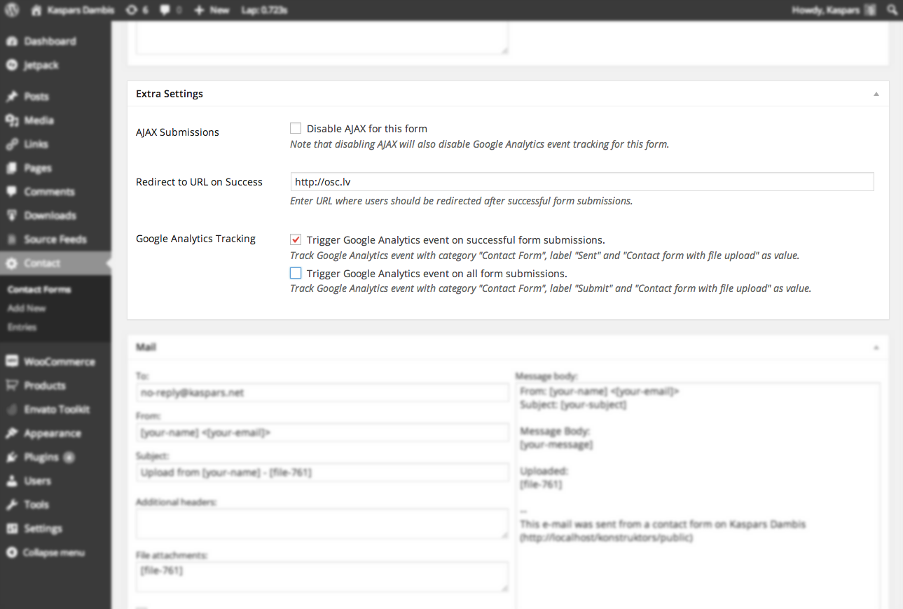

# Contact Form 7 Controls

Source of the [Contact Form 7 Controls plugin](https://formcontrols.com) for WordPress.

## 🚀 Get PRO

Support the continued development of this plugin by [pre-ordering the PRO version](https://formcontrols.com/pro) that will include advanced analytics and tracking features. [Learn more →](https://formcontrols.com/pro)

## Install

Search for "Contact Form 7 Controls" under "Plugins → Add New" in your WordPress dashboard.

Install as a [Composer dependancy](https://packagist.org/packages/kasparsd/contact-form-7-extras):

	composer require kasparsd/contact-form-7-extras

## Contribute

We use [Composer](https://getcomposer.org) for managing PHP development dependencies while [Node.js](https://nodejs.org) is used for most scripting needs, building the plugin release and deploying to WP.org via [@wpelevator/wp-release](https://www.npmjs.com/package/@wpelevator/wp-release) with [changesets](https://npmjs.com/package/@changesets/cli)-driven release pull requests.

1. Clone the plugin repository:

	   git clone https://github.com/kasparsd/contact-form-7-extras.git

2. Setup the development environment and tools:

	   npm install
	   composer install

3. Build a release ZIP of the plugin:

	   npm run zip

## Screenshot

